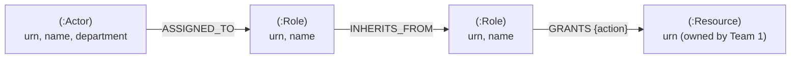

# edte-iam-service: Design Notes
 
Team 2: Identity & Entitlement Resolver (Security Layer)
 
These notes cover the graph model, REST API contracts and input file formats for the IAM service. They are a working design and may change as the instructor answers the open questions at the end.
 
## 1. Scope
 
The service ingests RBAC configuration from JSON/CSV files, stores it in Neo4j, and answers three questions:
 
1. What can this actor access, and through which roles? (effective permissions)
2. By which paths does an actor reach a given resource?
3. Where are the circular role assignments and toxic permission combinations?
## 2. Graph model
 

 
### Nodes
 
| Label | Properties | URN pattern | Example |
| --- | --- | --- | --- |
| `:Actor` | `urn`, `name`, `department` | `urn:actor:{actor_id}` | `urn:actor:intern_khaled` |
| `:Role` | `urn`, `name` | `urn:role:{role_id}` | `urn:role:finance_operator` |
| `:Resource` | `urn` | `urn:resource:{system_id}:{type}:{name}` | `urn:resource:billing_db:table:invoices` |
 
### Relationships
 
| Relationship | Direction | Meaning |
| --- | --- | --- |
| `ASSIGNED_TO` | Actor to Role | The actor holds this role directly. |
| `INHERITS_FROM` | Child Role to Parent Role | The child gets every permission the parent grants. |
| `GRANTS {action}` | Role to Resource | The role allows this action on the resource. |
 
### Design rules
 
- Every node is keyed by its canonical URN. Arbitrary IDs are not accepted.
- All writes use `MERGE`, so re-running an ingest never creates duplicates.
- `:Resource` nodes belong to Team 1. This service only `MERGE`s a stub on `urn` and never sets other properties on it.
- Uniqueness constraints from the global constraints script are created before any ingestion.
- No new labels or relationship types are added beyond the schema above.
- Groups are modelled as `:Role` nodes (pending instructor confirmation).
### Core query: effective permissions
 
```cypher
MATCH (a:Actor {urn: $actor_urn})-[:ASSIGNED_TO]->(r:Role)
MATCH path = (r)-[:INHERITS_FROM*0..]->(p:Role)-[g:GRANTS]->(res:Resource)
RETURN res.urn AS resource, collect(DISTINCT g.action) AS actions,
       [n IN nodes(path) WHERE n:Role | n.urn] AS delegation_chain
```
 
Revoking an intermediate parent role removes the `INHERITS_FROM` edge, so downstream actors lose the transitive permissions on the next query.
 
## 3. REST API contracts
 
All endpoints live under `/api/v1/iam` and are documented through the generated OpenAPI page at `/docs`.
 
### `POST /api/v1/iam/ingest`
 
Batched ingest. The request body has the same shape as the three input files.
 
```json
{
  "users": [],
  "roles": [],
  "policies": []
}
```
 
Response:
 
```json
{
  "actors_written": 12,
  "roles_written": 8,
  "grants_written": 20,
  "cycles_detected": [["urn:role:a", "urn:role:b", "urn:role:a"]]
}
```
 
### `GET /api/v1/iam/actors/{actor_urn}/effective-permissions`
 
```json
{
  "actor_urn": "urn:actor:intern_khaled",
  "permissions": [
    {
      "resource_urn": "urn:resource:billing_db:table:invoices",
      "actions": ["WRITE"],
      "delegation_chain": ["urn:role:intern", "urn:role:finance_operator"]
    }
  ]
}
```
 
### `GET /api/v1/iam/paths?actor_urn={actor_urn}&resource_urn={resource_urn}`
 
```json
{
  "actor_urn": "urn:actor:intern_khaled",
  "resource_urn": "urn:resource:billing_db:table:invoices",
  "paths": [
    [
      "urn:actor:intern_khaled",
      "urn:role:intern",
      "urn:role:finance_operator",
      "urn:resource:billing_db:table:invoices"
    ]
  ]
}
```
 
### `GET /api/v1/iam/conflicts/toxic-combinations?rule_a={rule}&rule_b={rule}`
 
Each rule is written as `ACTION:resource_urn` and split on the first colon.
 
```json
{
  "rule_a": "WRITE:urn:resource:billing_db:table:invoices",
  "rule_b": "EXECUTE:urn:resource:billing_db:table:payments",
  "actors": ["urn:actor:usr_1024"]
}
```
 
### Errors
 
| Status | When |
| --- | --- |
| 400 | Malformed URN or invalid action value |
| 404 | Unknown actor or resource URN |
| 422 | Request body fails schema validation |
 
## 4. CLI
 
```
python -m src.cli ingest-iam --users users.json --roles roles.json --policies policies.json
python -m src.cli audit-actor --urn urn:actor:intern_khaled
```
 
## 5. Input file formats
 
All identifiers are full URNs. The parsers reject anything that does not match the patterns in section 2.
 
**users.json**
 
```json
[
  {
    "urn": "urn:actor:intern_khaled",
    "name": "Khaled",
    "department": "Finance",
    "roles": ["urn:role:intern"]
  }
]
```
 
**roles.json**
 
```json
[
  {
    "urn": "urn:role:finance_operator",
    "name": "Finance Operator",
    "inherits_from": []
  },
  {
    "urn": "urn:role:intern",
    "name": "Intern",
    "inherits_from": ["urn:role:finance_operator"]
  }
]
```
 
**policies.json**
 
```json
[
  {
    "role": "urn:role:finance_operator",
    "resource": "urn:resource:billing_db:table:invoices",
    "action": "WRITE"
  }
]
```
 
## 6. Sample data requirements
 
The sample dataset lives in `data/` (`users.json`, `roles.json`, `policies.json`) and includes:
 
- A role hierarchy at least 5 levels deep
- At least one circular delegation (Role A to Role B to Role A)
- At least one toxic combination
- `urn:actor:intern_khaled` with write access to `urn:resource:billing_db:table:invoices` through inheritance (the same pattern as the grand integration test)
## 7. Test plan
 
| Layer | What is verified |
| --- | --- |
| Unit | URN validation, parsers, transitive resolution across 5+ levels, cycle detection without infinite loops |
| Integration (testcontainers) | Full RBAC graph ingestion, idempotent re-ingest, revoking a parent role removes transitive permissions |
 